# LCARSv2

Steam as one LCARS console. A theme for [Millennium](https://steambrew.app).

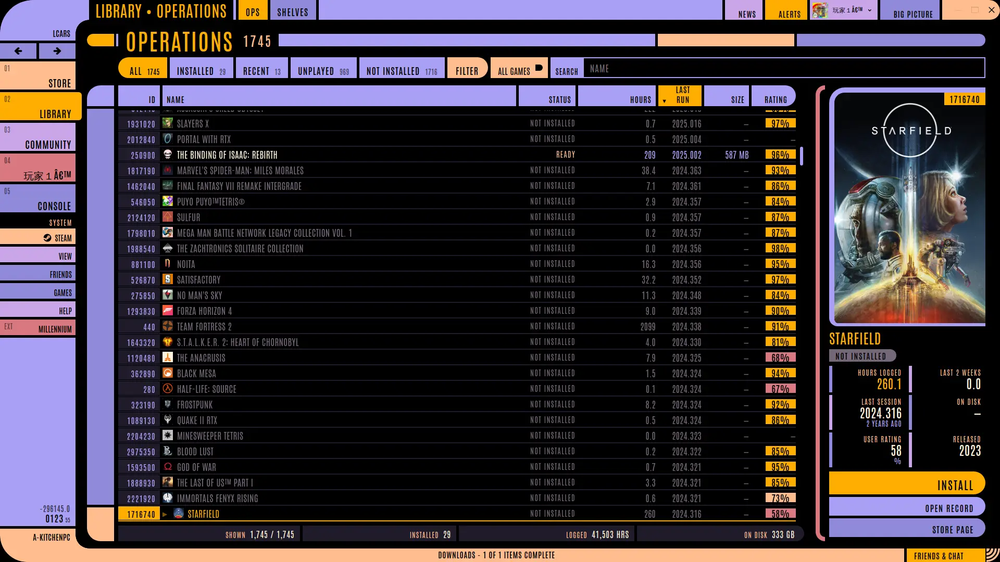

## Ops

The library as a spreadsheet. **OPS / SHELVES** in the top bar swaps between it and Steam's home.

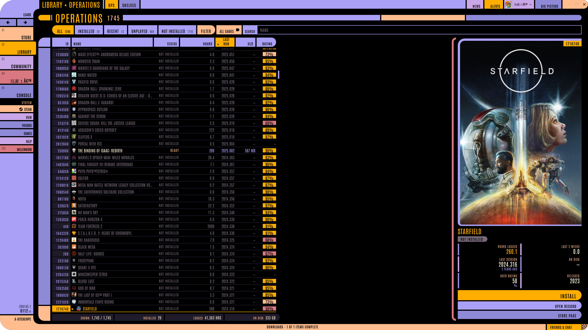

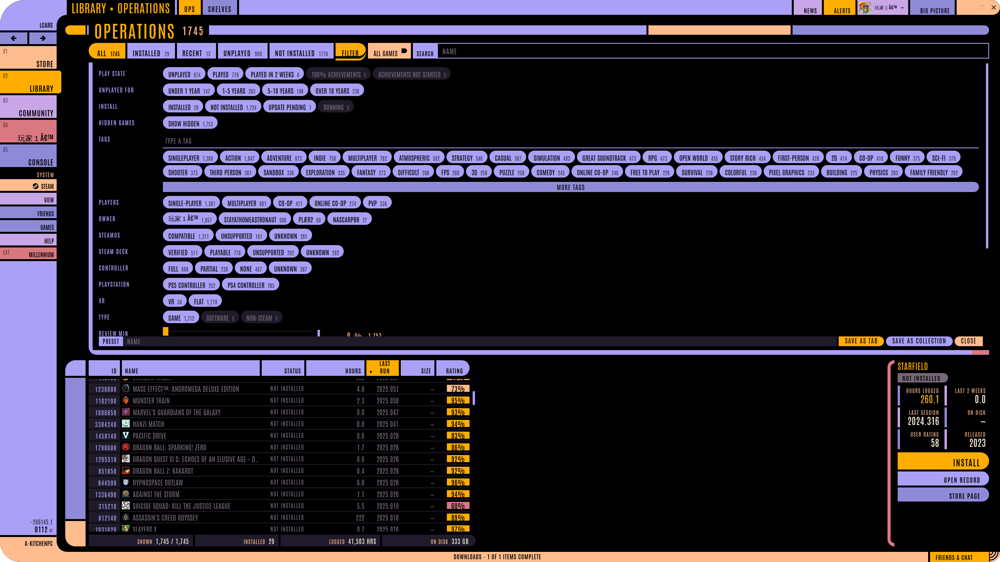

| | |
|---|---|
| Register | Every game, live Steam data. Click a header to sort |
| Columns | Drag to reorder, drag edges to resize, add more from the chooser |
| Tabs | All, Installed, Recent, Unplayed, Not installed, plus your saved views. Right-click to remove |
| Filter | Play state, tags, players, Deck, reviews and more. AND across groups. Ctrl-click a tag for OR |
| Save | **Save as tab** stays in Ops. **Save as collection** writes a Steam collection |
| Record | Art, stats and Play / Install, Open record, Store page |
| Keys | Arrows and PgUp/PgDn move, Enter opens, Esc clears search |

## Everything else

| | |
|:-:|:-:|
| 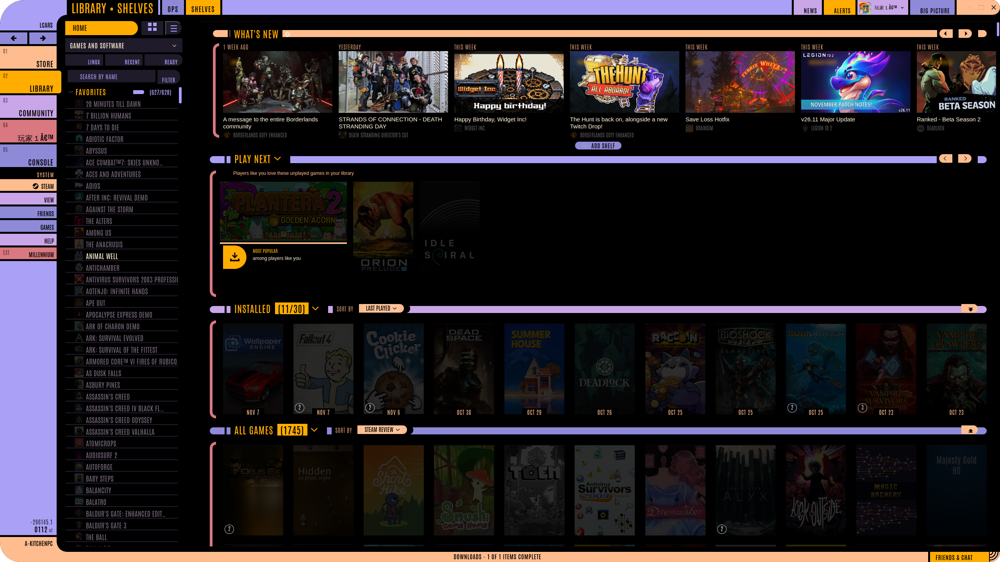 | 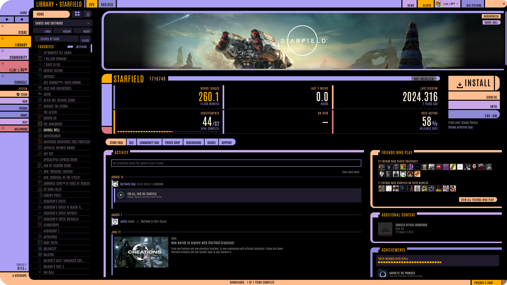 |
| 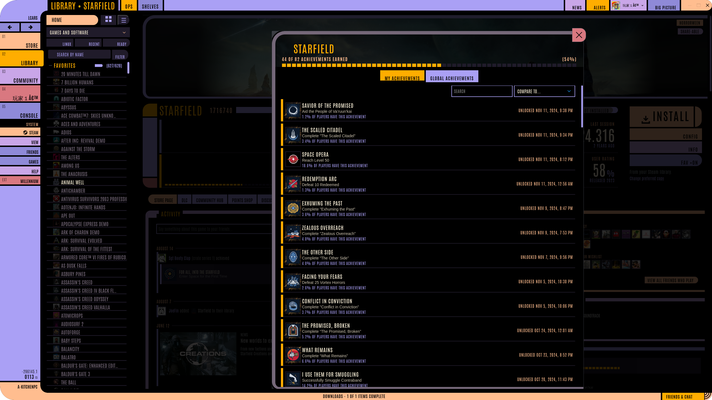 | 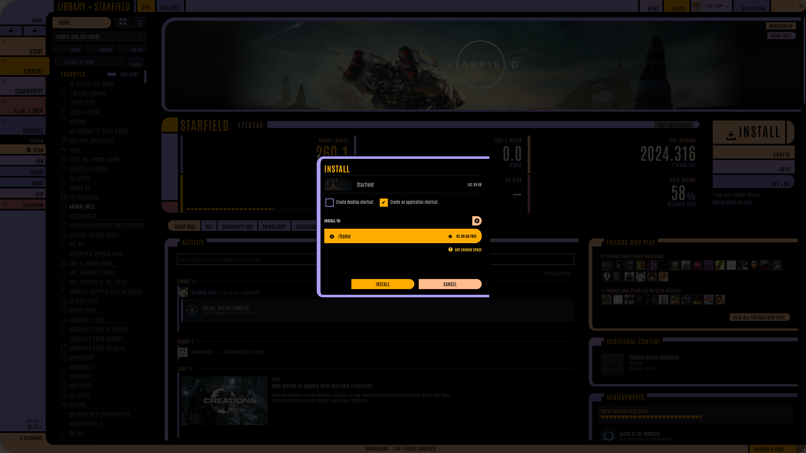 |
| 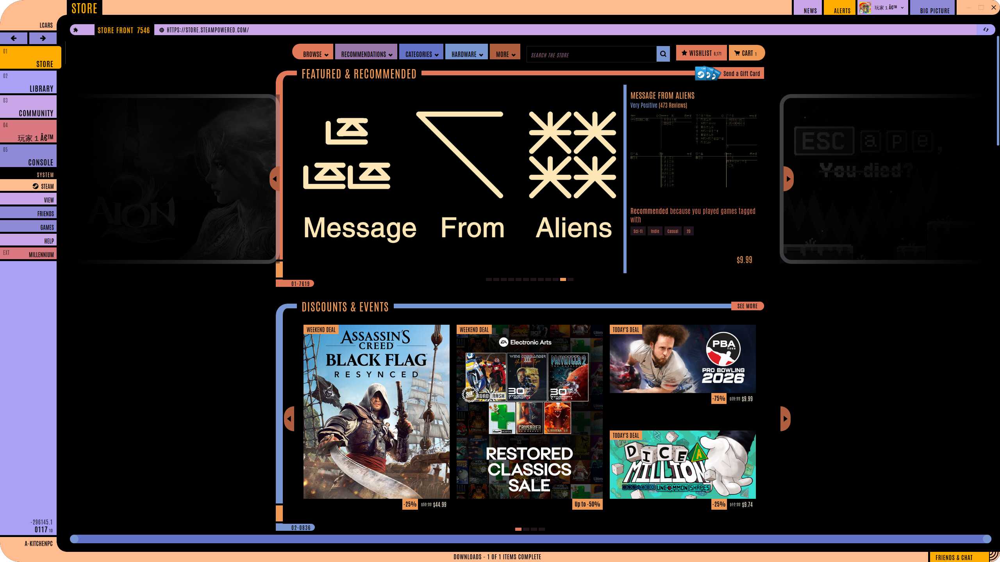 | 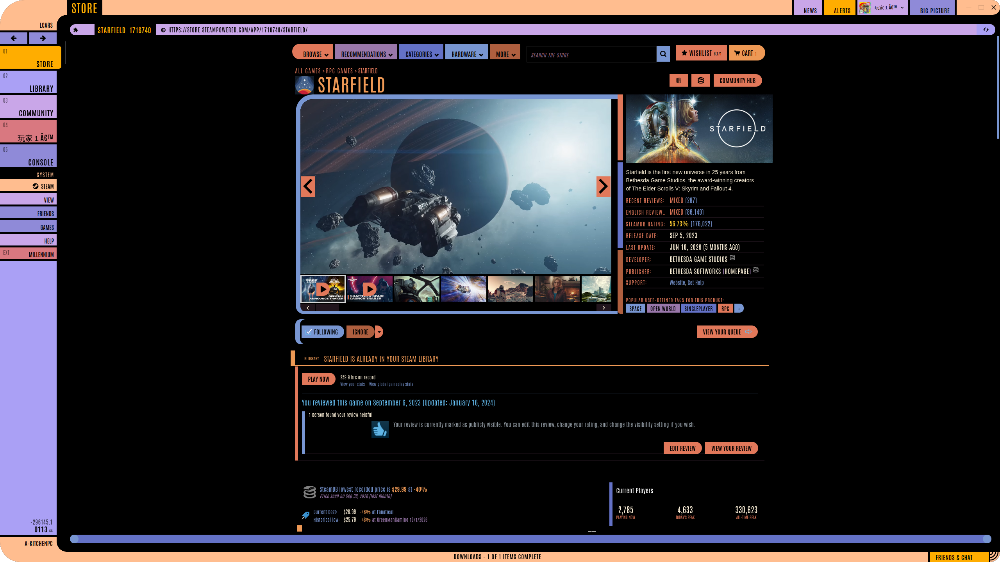 |
| 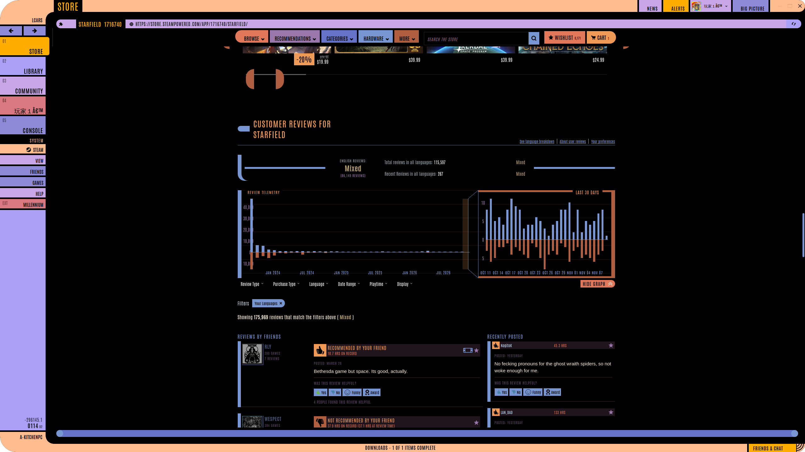 | 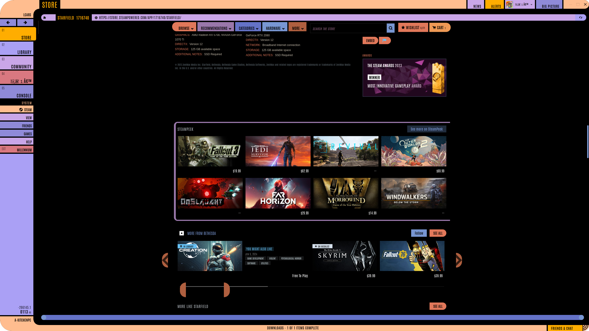 |
| 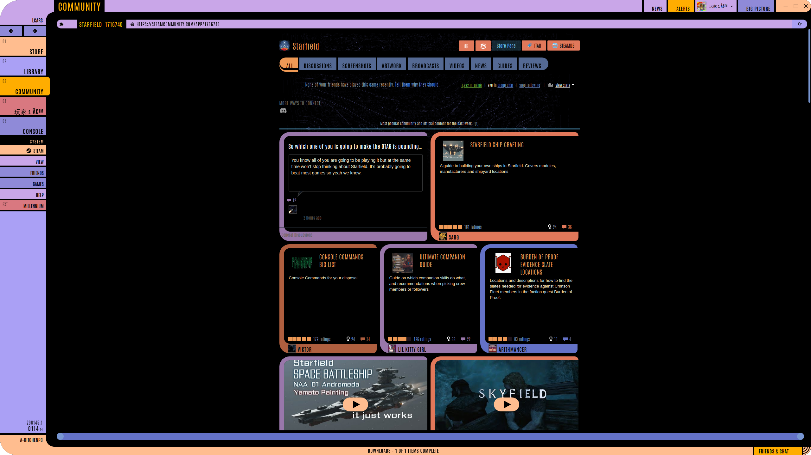 | 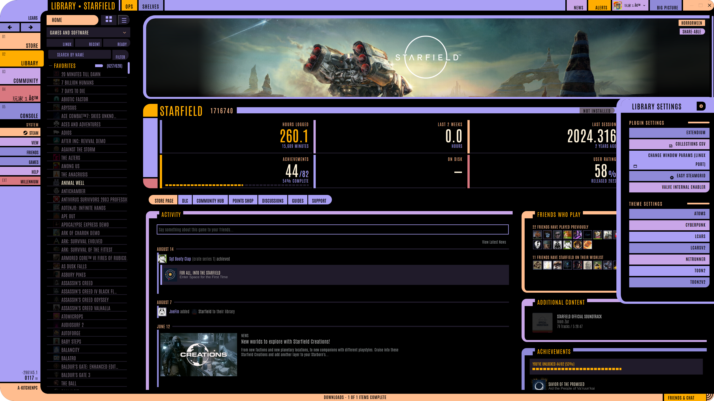 |
| 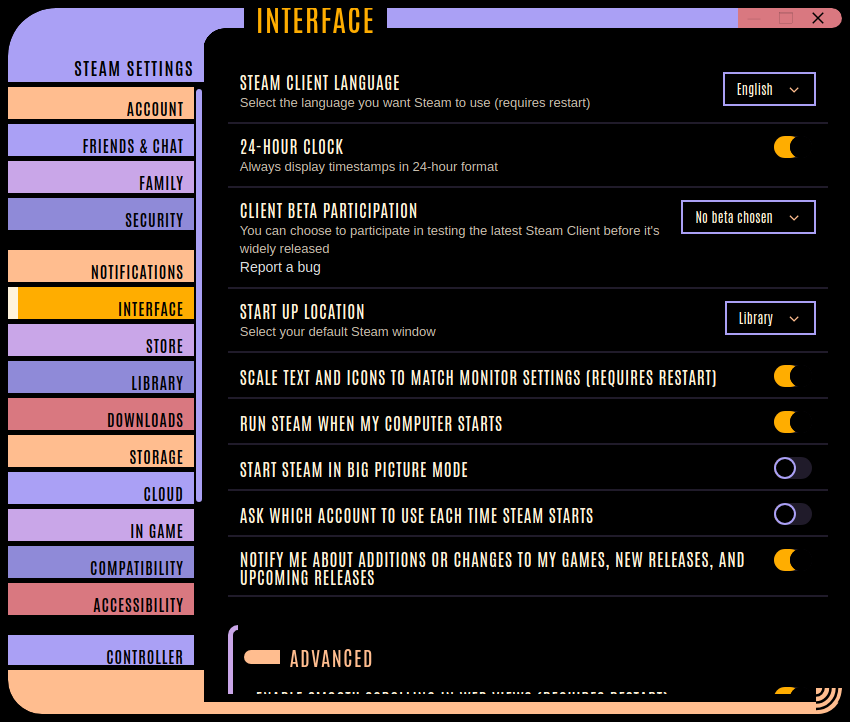 | 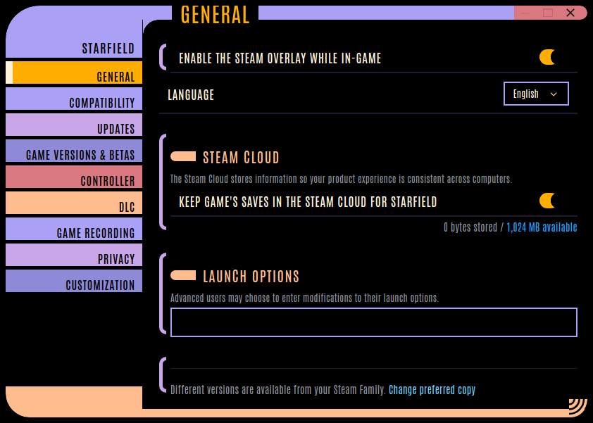 |

## Install

1. Install [Millennium](https://steambrew.app).
2. Put this folder in `Steam/millennium/themes/LCARSv2`.
3. Pick **LCARSv2** in Millennium's theme settings.

## Options

| Option | Does |
|---|---|
| Palette | LCARS colour era |
| Stardate | Stardate or calendar date |
| Military time | 24-hour clock |
| UI sounds | Synthesized console chirps |
| Boot jingle | Boot tune. Named themes need your own files in `jingles/local/` |
| Debug menu | Alt-click anything to leave a note on it |

## Addons

| Addon | Status |
|---|---|
| [Change Window Params](https://steambrew.app) | Transparent window corners |
| Extendium | Themed; runs the extensions below |
| SteamDB | Themed |
| Augmented Steam | Themed |
| SteamPeek | Themed |
| Easy SteamGrid | Themed |

## Credits

[Antonio](fonts/OFL.txt) font: SIL Open Font License. Unofficial fan project, not affiliated with CBS or Paramount. Star Trek and LCARS belong to their owners.
